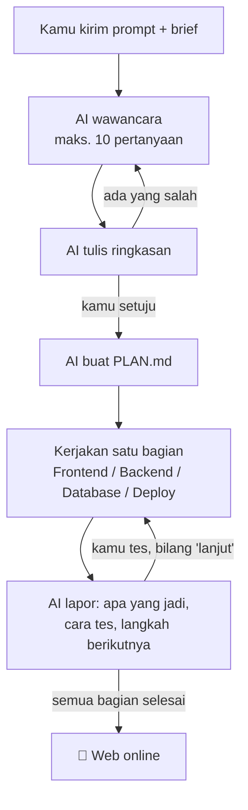

<div align="center">

# Prompt For All

**Satu prompt untuk mulai belajar web & app development bareng AI, dari ide sampai online.**


</div>

---

## 👋 Selamat Datang


Repo ini kubuat untuk kamu yang ingin bikin website atau aplikasi, tapi bingung harus mulai dari mana. Belum paham stack, database, atau deployment? Tidak masalah. Kamu cukup punya ide, AI yang akan memandu sisanya.

## 📑 Daftar Isi

- [Masalah yang Diselesaikan](#-masalah-yang-diselesaikan)
- [Alur Kerja](#-alur-kerja)
- [Prasyarat](#-prasyarat)
- [Cara Pakai](#-cara-pakai)
- [Tips: Hemat Limit dan Context](#-tips-hemat-limit-dan-context)
- [Project yang Terus Tumbuh](#-project-yang-terus-tumbuh)
- [Kontribusi dan Masukan](#-kontribusi-dan-masukan)
- [Lisensi](#-lisensi)

## 🎯 Masalah yang Diselesaikan

Belajar full stack itu berat: frontend, backend, database, deployment, keamanan. Pemula biasanya tersesat di tutorial yang terpisah-pisah dan tidak pernah sampai ke web yang benar-benar online.

[`plan_for_app_project.md`](./Prompt%20Collections/plan_for_app_project.md) membuat AI berperan sebagai **agency web & app development**, dan kamu sebagai client-nya. Alurnya:

| Tahap | Yang terjadi |
| --- | --- |
| 1. Wawancara | AI bertanya maksimal 10 pertanyaan, satu per pesan, lengkap dengan rekomendasinya. |
| 2. Rencana | AI menulis `PLAN.md`: stack, struktur folder, dan daftar pekerjaan yang bisa kamu cek sendiri. |
| 3. Pengerjaan | Planning → Frontend → Backend → Database → Deployment, satu per satu, sampai webmu online. |

Selama proses, kamu cukup mengetes sebagai pengguna biasa. AI menjelaskan setiap langkah dengan bahasa awam, minta izin sebelum ada biaya atau penghapusan data, dan menjaga keamanan tanpa perlu kamu minta.

## 🔄 Alur Kerja



**Yang kamu lihat sebagai user:**

| Saat | Di layarmu |
| --- | --- |
| Wawancara | Satu pertanyaan per pesan, plus rekomendasi AI. Bingung? Jawab "ikut rekomendasi". |
| Rencana | File `PLAN.md` muncul di folder project. Ini peta project-mu. |
| Pengerjaan | Tiap selesai satu tugas, AI kasih link/halaman untuk kamu klik dan cek. |
| Butuh aksimu | Langkah bernomor, misalnya buat akun atau salin API key, lengkap dengan tanda kalau sudah berhasil. |
| Ada biaya / hapus data | AI berhenti dan minta izinmu dulu. |

Teknisnya, semua kode, konfigurasi, dan file ditulis AI langsung di folder project. `PLAN.md` jadi "ingatan" AI: setiap sesi baru, AI membacanya dulu lalu lanjut dari posisi terakhir.

## 🧰 Prasyarat

> [!IMPORTANT]
> Prompt ini memakai skill **grill-me** dari [mattpocock/skills](https://github.com/mattpocock/skills) untuk tahap wawancara. Install skill tersebut lebih dulu agar AI bisa "menginterogasi" idemu sampai jelas.

1. AI coding agent yang mendukung skills, contohnya [Claude Code](https://claude.com/claude-code).
2. Skill dari [mattpocock/skills](https://github.com/mattpocock/skills). Ikuti cara install di README repo tersebut.
3. Folder kosong untuk project barumu.

## 🚀 Cara Pakai

1. Buat folder project kosong, lalu buka AI di folder itu.
2. Buka [`plan_for_app_project.md`](./Prompt%20Collections/plan_for_app_project.md) dan salin isi kotak **Prompt**.
3. Isi bagian **Brief** yang bertanda `[seperti ini]`. Tidak tahu jawabannya? Tulis `[belum tahu]`, AI akan menanyakannya.
4. Kirim, lalu jawab pertanyaan AI satu per satu.
5. Di sesi berikutnya, cukup tulis: *"Baca PLAN.md, lalu lanjutkan dari posisi terakhir."*

## 💡 Tips: Hemat Limit dan Context

Merasa AI mulai lambat, lupa, atau limit cepat habis? Pakai cara ini.

### 1. Aturan 300K

Pantau penggunaan context selama sesi. Begitu mendekati **300K token**, minta AI:

```text
Buatkan handover.md berisi progres, keputusan, dan langkah berikutnya,
supaya bisa dilanjutkan di sesi baru.
```

Buka sesi baru, kirim `handover.md` ke AI, dan pekerjaan lanjut dari titik terakhir tanpa mengulang dari nol.

### 2. Combo Power

```
Aturan 300K  +  Caveman  +  Prompt dari Ansa  =  bangun web dalam 1x Session !
```

- **Aturan 300K** menjaga sesi tetap ringan dan fokus.
- **[Caveman](https://github.com/JuliusBrussee/caveman)** membuat jawaban AI ringkas, sehingga token lebih hemat.
- **Prompt dari Ansa** ([`plan_for_app_project.md`](./Prompt%20Collections/plan_for_app_project.md)) memberi AI alur kerja yang jelas dari awal sampai online.

## 🌱 Project yang Terus Tumbuh

Repo ini bukan project sekali jadi lalu ditinggal. Saya sendiri juga masih belajar, jadi setiap kali menemukan cara yang lebih baik, prompt dan tips di sini akan ikut diperbarui.

Anggap repo ini sebagai **forum belajar bersama**: tempat kita berbagi prompt, pengalaman, dan cara kerja dengan AI.

## 🤝 Kontribusi dan Masukan

Semua masukan diterima, sekecil apa pun.

- Punya saran, menemukan bug di prompt, atau ingin berbagi hasil? Buka [**Issue**](https://github.com/AlberikStephan/Prompt-For-All/issues).
- Ingin menambah atau memperbaiki prompt? Silakan kirim Pull Request.

## 📄 Lisensi

Dirilis di bawah [MIT License](./LICENSE). Bebas dipakai, diubah, dan dibagikan.

<div align="center">

Dibuat dengan ☕ oleh [Alberik Stephan (Ansa)](https://github.com/AlberikStephan)

**⭐ Kalau repo ini membantu, beri bintang supaya lebih banyak pemula menemukannya. Thank You**

</div>
